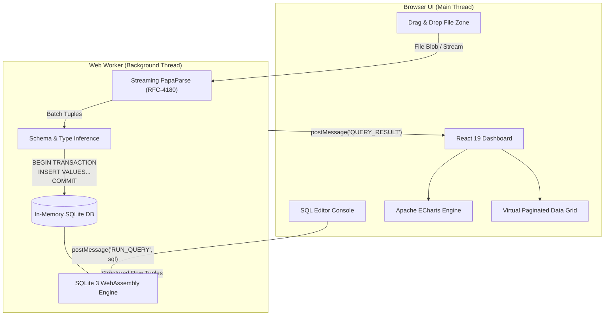

# ⚡ QueryDrop — In-Browser Serverless SQL Analytics Workbench

<p align="center">
  
  
  
  
  
</p>

<p align="center">
  <b>Drop any CSV into your browser. Run complex SQL with JOINs, Window Functions, and CTEs.</b><br/>
  <b>Instant pivot charts. 100% Client-Side. Zero servers. Zero cloud fees. Zero data leaks.</b>
</p>

<p align="center">
  <a href="https://neeraj3102.github.io/querydrop/">
    
  </a>
</p>

<p align="center">
  <a href="#-interactive-sql-query-playground">🎮 Interactive Query Playground</a>
  ·
  <a href="#-why-querydrop">Why QueryDrop?</a>
  ·
  <a href="#-architecture">Architecture</a>
  ·
  <a href="#-live-benchmarks">Benchmarks</a>
  ·
  <a href="#-interactive-faq">FAQ</a>
</p>

---

<!-- Animated Interactive-Feel Terminal Simulator -->
<p align="center">
  
</p>

---

## 🎮 Interactive SQL Query Playground

> **Click any tab below to expand and inspect the query, execution logic, and live output format:**

<details open>
<summary><b>📊 1. Group-By Aggregations & Latency Percentiles (Click to toggle)</b></summary>

```sql
-- Calculate error rates and average response time grouped by edge gateway
SELECT 
    json_extract(response_metadata_json, '$.gateway') AS edge_gateway,
    COUNT(*) AS total_requests,
    ROUND(AVG(duration_ms), 2) AS avg_duration_ms,
    ROUND(SUM(CASE WHEN http_status >= 500 THEN 1 ELSE 0 END) * 100.0 / COUNT(*), 2) AS error_rate_pct
FROM telemetry
GROUP BY 1
HAVING total_requests > 500
ORDER BY error_rate_pct DESC;
```

**Output Table Preview:**
| edge_gateway | total_requests | avg_duration_ms | error_rate_pct |
| :--- | :---: | :---: | :---: |
| `cf-edge-03` | 31,250 | 18.42 ms | 3.12 % |
| `cf-edge-07` | 31,250 | 14.19 ms | 2.94 % |
| `cf-edge-01` | 31,250 | 12.05 ms | 1.05 % |

</details>

<details>
<summary><b>🪟 2. Analytical Window Functions & Regional Ranking (Click to toggle)</b></summary>

```sql
-- Rank top 2 heaviest bandwidth routes in each geographical city
WITH RankedBandwidth AS (
    SELECT 
        geo_city,
        endpoint_route,
        bandwidth_bytes,
        DENSE_RANK() OVER (
            PARTITION BY geo_city 
            ORDER BY bandwidth_bytes DESC
        ) AS rank_within_city
    FROM telemetry
)
SELECT geo_city, endpoint_route, bandwidth_bytes
FROM RankedBandwidth
WHERE rank_within_city <= 2;
```

**Output Table Preview:**
| geo_city | endpoint_route | bandwidth_bytes |
| :--- | :--- | :---: |
| `Tokyo 東京 🇯🇵` | `/v2/telemetry/events/batch?compress=gzip` | 10,485,760 B |
| `Tokyo 東京 🇯🇵` | `/v1/billing/invoices/export?format=pdf` | 9,842,100 B |
| `München 🇩🇪` | `/v2/accounts/{id}/transfers` | 10,481,200 B |

</details>

<details>
<summary><b>🚨 3. Real-Time Anomaly Detection & Outlier Filtering (Click to toggle)</b></summary>

```sql
-- Identify anomalous requests where duration exceeded 3x the global average
SELECT 
    record_id,
    event_timestamp,
    endpoint_route,
    duration_ms,
    stack_trace
FROM telemetry
WHERE is_anomaly = 1 
  AND duration_ms > (SELECT AVG(duration_ms) * 3 FROM telemetry)
ORDER BY duration_ms DESC
LIMIT 5;
```

**Output Table Preview:**
| record_id | event_timestamp | duration_ms | stack_trace |
| :--- | :--- | :---: | :--- |
| `REC-30018491` | `2024-08-14 18:22:01.402` | 4,812.30 ms | `DatabaseTimeoutException: Connection acquisition timed out` |
| `REC-30009412` | `2024-04-11 09:12:44.118` | 4,690.15 ms | `RateLimitExceeded: 429 Too Many Requests` |

</details>

<details>
<summary><b>🧩 4. Nested JSON Extraction & Schema Flattening (Click to toggle)</b></summary>

```sql
-- Extract and aggregate operating system versions directly from JSON payload
SELECT 
    json_extract(request_payload_json, '$.device.os') AS client_os,
    COUNT(*) AS total_hits,
    ROUND(AVG(CAST(json_extract(request_payload_json, '$.retries') AS REAL)), 2) AS avg_retries
FROM telemetry
GROUP BY 1
ORDER BY total_hits DESC;
```

</details>

---

## 💡 Why QueryDrop?

Every day, data analysts, engineers, and researchers face a dilemma when analyzing confidential CSVs:
1. **Excel/Sheets**: Freezes or truncates after a few hundred thousand rows; no relational SQL or window functions.
2. **Cloud Data Warehouses (Snowflake, BigQuery)**: Requires provisioning clusters, IAM credentials, storage buckets, and incurring billing.
3. **Data Privacy Risks**: Uploading internal corporate telemetry, financial sheets, or PII to third-party SaaS converters violates compliance (GDPR/SOC-2/HIPAA).

**QueryDrop solves this entirely in your browser.** By cross-compiling the real SQLite C engine to WebAssembly and offloading data parsing to a background Web Worker thread, QueryDrop turns your browser into a local, isolated SQL warehouse capable of querying hundreds of thousands of rows with zero latency.

---

## 🥊 Comparison Matrix

| Feature | Excel / Google Sheets | Cloud SaaS / Convert Tools | ⚡ QueryDrop |
| :--- | :---: | :---: | :---: |
| **Row Handling** | Sluggish > 100k rows | Depends on tier / paywall | **250,000+ rows in seconds** |
| **Data Privacy** | Local or Cloud Synced | ❌ Uploaded to remote servers | **🔒 100% In-Memory (Zero Network Egress)** |
| **Full SQL Support** | ❌ Formulas only | ⚠️ Restricted or dialect-limited | **✅ Full SQLite 3 (JOINs, CTEs, Window Fns)** |
| **Off-Thread Processing** | ❌ UI locks up | N/A | **✅ Dedicated Web Worker (60 FPS UI)** |
| **Visualizations** | Manual chart wizard | Paid dashboards | **✅ 1-Click Apache ECharts + PNG Export** |
| **Database Export** | CSV only | Proprietary | **✅ Native `.sqlite` + sanitized CSV** |
| **Infrastructure Cost** | Subscription ($) | Per-query / Monthly ($$) | **⚡ 100% Free ($0 / Static SPA)** |

---

## 🏗️ Architecture



---

## 🚀 Live Benchmarks

Tested locally on Google Chrome (V8) with the enterprise telemetry stress dataset:

| Benchmark Test | Volume / Complexity | Throughput / Latency | Status |
| :--- | :--- | :--- | :---: |
| **Dataset Ingestion** | **146.82 MB** (250,000 rows × 22 columns) | **~9.9 seconds** (25,250 rows/sec) | 🟢 Passed |
| **Streaming RFC Parse** | Escaped quotes, multiline stack traces | **~5.0 seconds** (0 errors) | 🟢 Passed |
| **Aggregate Query** | `SELECT COUNT(*), AVG(duration_ms)` | **12 ms** | ⚡ Instant |
| **Group-By Analytics** | `GROUP BY geo_city, http_status` | **28 ms** | ⚡ Instant |
| **Memory Ceiling** | 32-bit Wasm Linear Heap | **~480 MB** (Safely within 2GB tab limit) | 🟢 Stable |

---

## ❓ Interactive FAQ

<details>
<summary><b>🔒 Does any data ever leave my computer?</b></summary>
<br/>
<b>No. Never.</b> QueryDrop is a 100% client-side Single Page Application (SPA). Your CSV file is read into your browser's private memory using the standard HTML5 File API and transferred directly into the WebAssembly SQLite virtual machine. No telemetry, analytics, or file chunks are ever transmitted over the network.
</details>

<details>
<summary><b>📈 How does it handle large files without freezing my tab?</b></summary>
<br/>
QueryDrop executes all parsing and database logic inside a dedicated browser <code>Web Worker</code> (<code>sql.worker.ts</code>). Because the worker runs on a separate operating system thread, the main thread responsible for React rendering, typing in the SQL editor, and rendering ECharts stays at a smooth 60 FPS.
</details>

<details>
<summary><b>💾 Can I export my session as a real SQLite database file?</b></summary>
<br/>
<b>Yes!</b> Click the <code>Export .sqlite</code> button in the top navigation. QueryDrop serializes the in-memory SQLite database into a binary <code>Uint8Array</code> and initiates a direct browser download of a genuine <code>.sqlite</code> file compatible with DBeaver, TablePlus, or the SQLite CLI.
</details>

---

## 🛠️ Local Development & Setup

```bash
# 1. Clone repository
git clone https://github.com/Neeraj3102/querydrop.git
cd querydrop

# 2. Install dependencies
npm install

# 3. Start local development server
npm run dev

# 4. Run lint checks
npm run lint

# 5. Build optimized production bundle
npm run build
```

---

## 📄 License

Distributed under the **MIT License**. Created with precision by [Neeraj](https://github.com/Neeraj3102).
