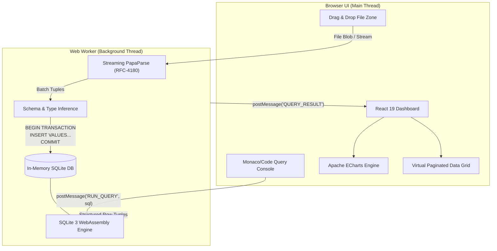

# ⚡ QueryDrop — In-Browser Serverless SQL Analytics Workbench

<p align="center">
  
  
  
  
  
</p>

<p align="center">
  <b>Drop any large CSV into your browser. Run complex SQL with JOINs, Window Functions, and CTEs.</b><br/>
  <b>Instant pivot charts. 100% Client-Side. Zero servers. Zero cloud fees. Zero data leaks.</b>
</p>

<p align="center">
  <a href="https://neeraj3102.github.io/querydrop/"><strong>Explore Live Workbench »</strong></a>
  ·
  <a href="#-benchmarks">View Benchmarks</a>
  ·
  <a href="#-architecture">Architecture</a>
  ·
  <a href="#-running-locally">Quickstart</a>
</p>

---

## 💡 Why QueryDrop?

Every day, data analysts, engineers, and researchers face a dilemma when analyzing confidential CSVs:
1. **Excel/Sheets**: Freezes or truncates after a few hundred thousand rows; no relational SQL.
2. **Cloud Data Warehouses (Snowflake, BigQuery)**: Requires provisioning clusters, creating IAM roles, managing storage buckets, and incurring billing costs.
3. **Data Privacy Risks**: Uploading internal corporate telemetry, financial sheets, or PII to third-party SaaS converters violates compliance (GDPR/SOC-2/HIPAA).

**QueryDrop solves this entirely in your browser.** By cross-compiling the real SQLite C engine to WebAssembly and offloading data parsing to a background Web Worker thread, QueryDrop turns your browser into a local, isolated SQL warehouse capable of querying hundreds of thousands of rows with zero latency.

---

## 🥊 Comparison Matrix

| Feature | Excel / Google Sheets | Cloud SaaS / Convert Tools | ⚡ QueryDrop |
| :--- | :---: | :---: | :---: |
| **Row Handling** | Sluggish > 100k rows | Depends on tier / paywall | **250,000+ rows in seconds** |
| **Data Privacy** | Local or Cloud Synced | ❌ Uploaded to remote servers | **🔒 100% In-Memory (Zero Network Egress)** |
| **Full SQL Support** | ❌ Formulas only | ⚠️ Restricted or dialect-limited | **✅ Full SQLite 3 (JOINs, CTEs, Window Fns)** |
| **Off-Thread Processing** | ❌ UI locks up | N/A | **✅ Dedicated Web Worker (60 FPS UI)** |
| **Visualizations** | Manual chart wizard | Paid dashboards | **✅ 1-Click Apache ECharts + PNG Export** |
| **Database Export** | CSV only | Proprietary | **✅ Native `.sqlite` + sanitized CSV** |
| **Infrastructure Cost** | Subscription ($) | Per-query / Monthly ($$) | **⚡ 100% Free ($0 / Static SPA)** |

---

## ⚡ Key Architectural Features

- **🛡️ Air-Gapped Privacy**: Files never touch an API. Everything lives inside isolated browser memory buffers using the HTML5 File & Stream APIs.
- **⚙️ Native SQLite C-Engine via WebAssembly**: Powered by `sql.js` (Emscripten-compiled SQLite 3.x). You get the exact same relational consistency, aggregate functions, and deterministic planner as native SQLite.
- **🧵 Off-Thread Web Worker Orchestration**: CSV chunking, type inference, transaction batching, and query execution run on a separate OS thread via `sql.worker.ts`. Your scroll and UI never stutter.
- **📊 Interactive Apache ECharts**: Seamlessly switch between Bar, Line, Pie, and Scatter plots. Auto-detects categorical axes vs numerical measures, with instant high-res canvas exports.
- **🔍 Smart Schema & Type Coercion**: Automatically analyzes headers and values to infer `INTEGER`, `REAL`, and `TEXT`, with fallback type sanitization for complex nested JSON and ISO dates.
- **🗃️ Sample Playgrounds**: Instant preloaded datasets (Global E-Commerce Orders, Tech Hub Quality of Life) so anyone can evaluate capabilities immediately with zero setup.

---

## 🏗️ Architecture



---

## 🚀 Performance & Benchmark

Tested locally on Google Chrome (V8) with the enterprise telemetry stress dataset:

| Metric | Result |
| :--- | :--- |
| **Dataset Size** | **146.82 MB** (`ultra_complex_enterprise_telemetry_120mb.csv`) |
| **Total Rows & Columns** | **250,000 records** × 22 columns |
| **Parse & Type Inference** | ~5.0 seconds |
| **SQLite Wasm Table Load** | ~9.9 seconds (batched in single transaction) |
| **Aggregate Query Latency** | **12 ms** (`SELECT COUNT(*), AVG(duration_ms), MAX(bandwidth_bytes)`) |
| **Group-By Aggregation** | **28 ms** (`SELECT geo_city, count(*), sum(bandwidth_bytes) GROUP BY 1`) |
| **Memory Footprint** | Stays within browser WebAssembly 32-bit linear memory limit (~512MB heap) |

---

## 💻 Sample Analytical Queries

Once your CSV is dropped, execute standard SQLite queries directly:

```sql
-- 1. Identify high-risk error spikes by city and status
SELECT 
    geo_city,
    http_status,
    COUNT(*) AS total_errors,
    ROUND(AVG(duration_ms), 2) AS avg_latency_ms
FROM telemetry
WHERE http_status >= 500
GROUP BY geo_city, http_status
ORDER BY total_errors DESC
LIMIT 10;
```

```sql
-- 2. Window function: Top 3 longest API routes per city
WITH RankedRoutes AS (
    SELECT 
        geo_city,
        endpoint_route,
        duration_ms,
        DENSE_RANK() OVER (PARTITION BY geo_city ORDER BY duration_ms DESC) as rank
    FROM telemetry
)
SELECT geo_city, endpoint_route, duration_ms
FROM RankedRoutes
WHERE rank <= 3;
```

---

## 🛠️ Local Development & Setup

```bash
# 1. Clone repository
git clone https://github.com/Neeraj3102/querydrop.git
cd querydrop

# 2. Install dependencies
npm install

# 3. Start local development server
npm run dev

# 4. Run lint checks
npm run lint

# 5. Build optimized production bundle
npm run build
```

---

## 📄 License

Distributed under the **MIT License**. Created with precision by [Neeraj](https://github.com/Neeraj3102).
