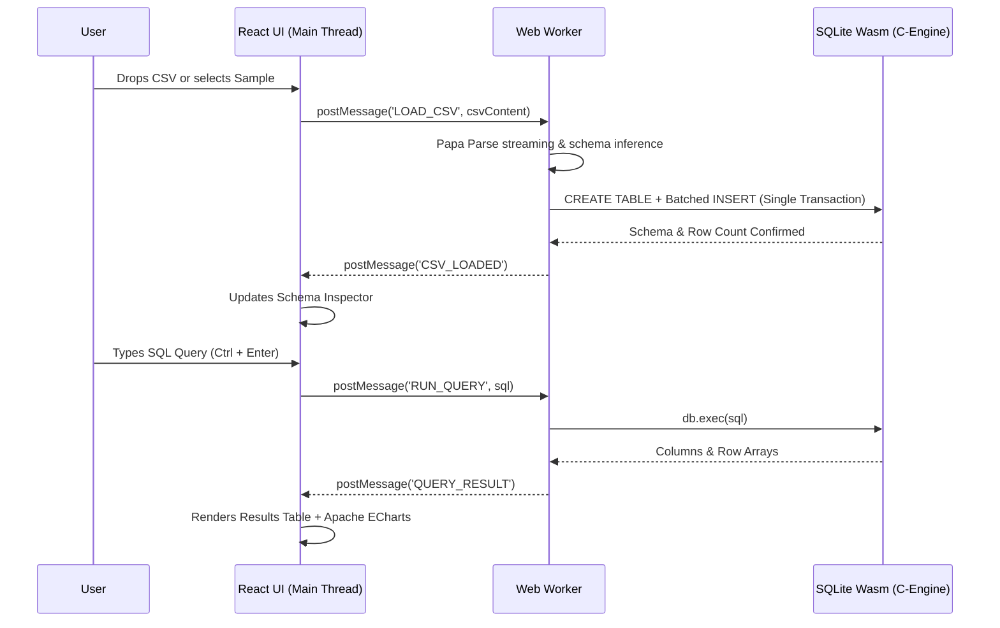

# ⚡ QueryDrop — In-Browser CSV Analytics Workbench

> **Drop large CSV files into your browser. Run blazing-fast SQLite queries via WebAssembly. Render dynamic pivot charts. 100% Client-Side. Zero data ever leaves your computer.**

### 🌐 [**Live Demo →** neeraj3102.github.io/querydrop](https://neeraj3102.github.io/querydrop/)

---

## 🎯 Key Highlights

- **🔒 100% Privacy-First:** Files are parsed and processed completely in local browser memory via the File API. No servers, no APIs, no tracking.
- **⚡ SQLite in WebAssembly:** The real, battle-tested SQLite C engine cross-compiled to WebAssembly (`sql.js`), delivering relational queries (`GROUP BY`, `JOIN`, subqueries, window functions) at near-native performance.
- **🧵 Off-Thread Web Worker:** Heavy parsing and database calculations are dispatched to a background Web Worker thread, guaranteeing zero UI freeze or jank.
- **📊 Dynamic Charts (Apache ECharts):** Instantly visualize any query results as interactive Bar, Line, Pie, or Scatter charts with custom axis selection and high-res PNG export.
- **🚀 One-Click Recruiter Demo Datasets:** Preloaded with sample eCommerce and Tech Hub datasets so recruiters or visitors can test the workbench in seconds without providing files.
- **💾 Free Hosting ($0 Budget):** 100% static SPA build deployable directly on **GitHub Pages**, **Vercel**, or **Cloudflare Pages**.

---

## 🏗 Architecture & Flow



---

## 🛠 Tech Stack

- **Frontend:** React 18, TypeScript, Vite
- **Styling:** Tailwind CSS v4 (Dark Theme, Sleek Cyan/Slate UI)
- **Database Engine:** `sql.js` (SQLite compiled to WebAssembly)
- **Concurrency:** Dedicated browser `Web Worker` (`sql.worker.ts`)
- **CSV Ingestion:** `Papa Parse` (Streaming parsing & type detection)
- **Visualizations:** `Apache ECharts`
- **Icons:** `Lucide React`

---

## 🚀 Running Locally

```bash
# Clone the repository
git clone https://github.com/Neeraj3102/querydrop.git
cd querydrop

# Install dependencies
npm install

# Start Vite local development server
npm run dev

# Build for production
npm run build
```

---

## 📄 License
MIT © [Neeraj](https://github.com/Neeraj3102)
